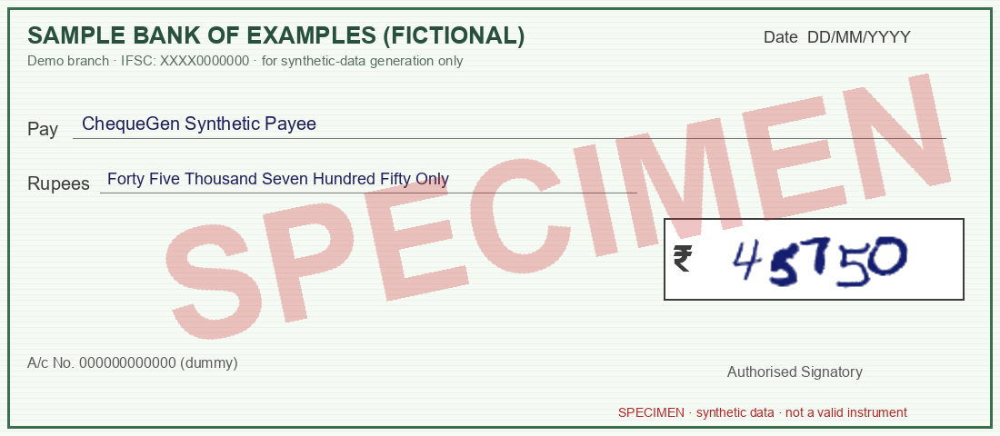
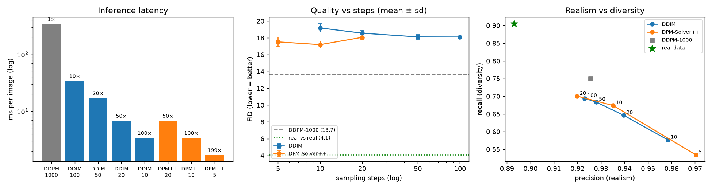
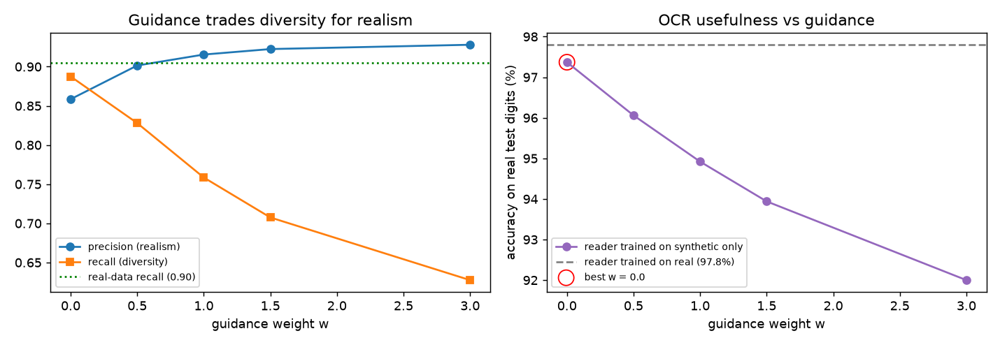
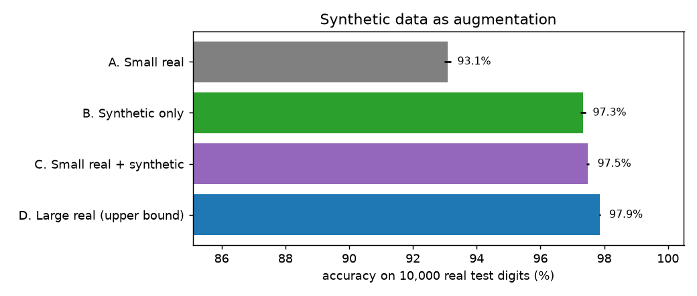

# ChequeGen — Overcoming the Slow-Sampling Limitation of Diffusion Models (DDPM → DDIM)

**Synthetic handwritten cheque-amount generation for privacy-safe banking OCR**
CAC course project: Generative Architectures (Transformer · GAN · VAE · Diffusion)



## The idea in one line
Diffusion models write the best handwriting of the four architectures, but they are slow (1000 sequential denoising steps per image). **DDIM** and **DPM-Solver++** reuse the *same trained network* with only 5–100 steps, and **class-conditioning with classifier-free guidance (CFG)** lets us ask for any digit. That makes it practical to generate large, privacy-free, labelled training sets for cheque-amount OCR.

## Results (version 2, GPU run)
NVIDIA GeForce RTX 4050 Laptop GPU · class-conditional U-Net with 3,689,473 parameters · 20,000 training steps, fp16 mixed precision, 46 min.
Every row: **2,000 images × 3 seeds**, guidance w = 1.5. FID / precision / recall use the 128-d features of an MNIST CNN (98.8% test accuracy).

| Sampler | Steps | Latency (ms/img) | Speed-up | FID ↓ (mean ± sd) | Precision ↑ | Recall ↑ | Label acc. |
|---|---|---|---|---|---|---|---|
| DDPM (baseline) | 1000 | 344.41 | 1.0× | **13.7 ± 0.4** | 0.926 | **0.749** | 99.9% |
| DDIM | 100 | 34.48 | 10.0× | 18.1 ± 0.2 | 0.923 | 0.694 | 100.0% |
| DDIM | 50 | 17.25 | 20.0× | 18.1 ± 0.3 | 0.928 | 0.684 | 100.0% |
| DDIM | 20 | 6.91 | 49.9× | 18.6 ± 0.3 | 0.940 | 0.646 | 100.0% |
| DDIM | 10 | 3.46 | 99.6× | 19.2 ± 0.5 | 0.958 | 0.576 | 100.0% |
| **DPM-Solver++ (app default)** | **20** | **6.91** | **49.9×** | 18.1 ± 0.3 | 0.920 | 0.700 | 100.0% |
| DPM-Solver++ | 10 | 3.46 | 99.6× | 17.2 ± 0.4 | 0.935 | 0.674 | 100.0% |
| DPM-Solver++ | 5 | 1.73 | 199.1× | 17.5 ± 0.6 | 0.970 | 0.535 | 100.0% |
| *Real vs real (two disjoint test subsets)* | — | — | — | *4.1* | *0.893* | *0.905* | — |

**What this shows**
* **Speed: the bottleneck is removed.** DDIM-50 is 20× faster, DPM-Solver++-20 is 50× and DPM-Solver++-5 is 199×, all with the same network. 1,00,000 cheque digits take **9.6 h with DDPM** vs **11.5 min with DPM-Solver++-20** on this laptop GPU.
* **Quality: the speed is not free.** Every few-step sampler has a FID about 3.5–5.5 points *worse* than DDPM-1000 (well outside the seed spread), and lower recall. In the v1 CPU run DDIM looked *better* than DDPM; with 4× more samples and 3 seeds that no longer holds.
* **DPM-Solver++ vs DDIM:** at 10 steps DPM-Solver++ is better on both FID (17.2 vs 19.2) and recall (0.674 vs 0.576) at identical cost; at 20 steps the two are about the same.
* **FID alone is misleading:** DPM-Solver++-5 has a lower FID than DPM-Solver++-20 but the lowest recall (0.535); its samples are neat but less varied. This is why precision/recall were added.
* **Conditioning works:** 99.9–100% of generated digits are read as the requested digit.



### Guidance sweep: the diversity limitation (DPM-Solver++-20, 5,000 digits per w)
A reader CNN is trained **only on synthetic digits** and tested on the 10,000 real MNIST test digits. Reference: the same reader trained on 5,000 **real** digits reaches **97.80%**.

| Guidance w | FID ↓ | Precision | Recall | Label acc. | Reader on synthetic only |
|---|---|---|---|---|---|
| **0.0 (chosen)** | 5.1 | 0.859 | **0.887** | 97.2% | **97.37%** |
| 0.5 | 10.4 | 0.901 | 0.828 | 99.9% | 96.06% |
| 1.0 | 17.5 | 0.915 | 0.758 | 100.0% | 94.92% |
| 1.5 (v1 setting) | 23.3 | 0.923 | 0.707 | 100.0% | 93.94% |
| 3.0 | 33.9 | 0.928 | 0.627 | 100.0% | 92.00% |

* Guidance trades diversity for neatness: recall falls from 0.89 to 0.63 as w rises from 0 to 3.
* For OCR training data, **diversity wins**: accuracy falls monotonically with w. Tuning w cuts the gap to real data from **3.9 points (w = 1.5) to 0.4 points (w = 0)**. The best value is at the edge of the sweep (no guidance), at the cost of ~3% mis-shaped digits.
* So most of the "diversity gap" in v1 was caused by guidance, not by the diffusion model itself.



### Synthetic data as augmentation (reader mean ± sd over 3 seeds)

| Training set | Real digits | Synthetic digits | Accuracy on 10,000 real test digits |
|---|---|---|---|
| A. Small real (consented set) | 500 | 0 | 93.09 ± 0.11% |
| B. Synthetic only (w = 0) | 0 | 5,000 | 97.34 ± 0.08% |
| C. Small real + synthetic | 500 | 5,000 | **97.49 ± 0.05%** |
| D. Large real (upper bound) | 5,000 | 0 | 97.86 ± 0.02% |

Adding 5,000 ChequeGen digits to 500 real ones lifts accuracy by **+4.4 points**, recovering **92%** of the gain that 4,500 more real (customer) digits would bring. C vs B is about the same (+0.15 points, ≈ 2 sd), so most of the benefit comes from the synthetic data itself.



## Caveats (read before quoting the numbers)
* **FID is relative, not absolute.** It uses an MNIST-CNN feature space, not Inception, so values are not comparable with published FIDs. In this space the 10 digit classes are far apart, so FID is sensitive to the class mix: the evaluation sets are class-balanced while the real reference set has MNIST's natural class proportions. This adds a similar bias to every sampler (comparisons between rows stay fair), but it means generated FIDs cannot be compared directly with the real-vs-real value of 4.1.
* **Section 7 vs Section 8 FID differ** (18.1 vs 23.3 for DPM-Solver++-20 at w = 1.5): the sweep computes FID on a random 2,000-image subset of a 5,000-image set, which changes the class mix. A re-check showed that this subset choice alone moves FID by about ±2–4 points. Use the sweep FID only to compare w values with one another; its conclusions rest on recall and OCR accuracy.
* **Some generated interpretation text in the notebook is slightly off** for this run and is corrected here: no few-step sampler matched the DDPM FID, so the app uses DPM-Solver++-20 (Section 7 text says "DDIM-50 is used as the reference default"); tuning w closes *most* of the OCR gap, not "part" of it; and the remaining diversity gap at the tuned w is small (recall 0.89 vs 0.90).
* **MNIST is not real cheque handwriting.** It is a public, privacy-free stand-in; a real deployment needs a cheque-amount dataset (e.g. CAR/LAR).
* Generated cheques use a fictional bank, a dummy account number and a **SPECIMEN** watermark: they are training data, never a usable instrument.

## Version 1 (CPU) for comparison
U-Net 16-32-64 (287,713 parameters), 5,000 steps on CPU, 500 images, 1 seed: DDPM-1000 1,112.7 ms/img, FID 58.5 · DDIM-50 54.1 ms (20.6×), FID 45.5 · DDIM-10 10.4 ms (106×), FID 42.1. Reader on 3,000 synthetic digits 88.2% vs 95.5% on real. The v1 real-vs-real floor (33.9) used training digits, which the evaluator had seen; v2 uses two disjoint held-out test subsets.

## Repository structure
```
ChequeGen.ipynb               # executed notebook: code + explanations + results (Phases 3 & 4)
ChequeGen_Notebook.pdf        # PDF export of the executed notebook
app.py                        # Gradio demo (Phase 4)
src/chequegen.py              # U-Net, noise schedule, DDPM/DDIM/DPM-Solver++ samplers, cheque renderer (shared with app)
checkpoints/chequegen_ema.pt  # trained EMA weights (3.7 M parameters) + tuned guidance best_w
results.json                  # all numbers of the run
figures/                      # every plot, sample grid and demo cheque
docs/                         # Phase 1 comparative study, Phase 2 proposal, RUN_ON_GPU.md (local GPU setup)
```

## How to run
```bash
python -m venv .venv && .venv\Scripts\activate          # Windows (source .venv/bin/activate on Linux/macOS)
pip install torch torchvision --index-url https://download.pytorch.org/whl/cu124
pip install -r requirements.txt
jupyter notebook ChequeGen.ipynb    # full run ≈ 100 min on an RTX 4050 Laptop (46 min training); CPU fallback uses a smaller model
python app.py                       # demo at http://127.0.0.1:7860
```
MNIST is downloaded automatically on first run. If the checkpoint matches the notebook settings, training is skipped.

## Method
* **Model:** class-conditional U-Net (28→14→7, channels 64-128-256), sinusoidal time embedding plus a learned label embedding added into every residual block. Label 10 means "no label".
* **Training:** noise-prediction MSE, 10% label dropout (for CFG), AdamW with warm-up and cosine decay, EMA weights, fp16 mixed precision, batch 256, 20,000 steps.
* **Baseline sampler:** DDPM ancestral sampling, 1000 steps.
* **Improvement 1:** DDIM (η = 0, deterministic) on a sub-sequence of 10–100 timesteps, same network.
* **Improvement 2:** DPM-Solver++(2M), a second-order multistep ODE solver, 5–20 steps, same network.
* **Guidance:** ε̂ = (1 + w)·ε(x, t, y) − w·ε(x, t, ∅), conditional and unconditional passes batched together.
* **Metrics:** latency; FID, precision and recall (Kynkäänniemi et al., k = 3) on MNIST-CNN features; label accuracy; OCR usefulness of synthetic data.

## References
Ho et al. 2020 (DDPM) · Song et al. 2021 (DDIM) · Lu et al. 2022 (DPM-Solver++) · Ho & Salimans 2022 (Classifier-Free Guidance) · Kynkäänniemi et al. 2019 (Precision/Recall) · Heusel et al. 2017 (FID) · LeCun et al. (MNIST)
